# 모델결과보고서 초안 — 4반 최승우

> 흐름: ① 알고 싶었던 것 → ② 확인 지표 → ③ EDA 결론 → ④ 변수 설계(파생변수) → ⑤ 요일 대비 판단 → ⑥ 모델링 → ⑦ 결과·한계
> 수치 근거: `experiments.csv`(2026-10-13 11:29), `01_EDA_피처인사이트.ipynb`, `02_Prophet_시계열분석.ipynb`
> 그림 파일: `현황판_그림/` (EDA 그림은 Train만으로 재실행해 저장, 성능 그림은 experiments.csv로 생성)

---

## 1. 분석 전에 알고 싶었던 것

과제는 "3일 뒤 KOSPI(Target_1) / 건강식품 쇼핑 지수(Target_2)가 오늘보다 오를까"를 확률로 맞히는 것이다. 모델을 만들기 전에 다섯 가지를 먼저 알고자 했다.

| # | 질문 | 왜 필요한가 |
|---|---|---|
| Q1 | **Target 자체는 어떤 구조인가?** 시기별·요일별로 상승 비율이 다른가? | 문제의 성격(규칙적인가, 잡음인가)에 따라 전략이 달라진다 |
| Q2 | **변수군(금융·포털·쇼핑·날씨)이 각 Target에 영향이 있는가?** 원값과 변화량 중 어느 형태로? | 287개 변수 중 무엇을 어떤 형태로 쓸지 정하기 위해 |
| Q3 | **그 관계가 시기가 바뀌어도 유지되는가?** | Private은 처음 보는 200일이다. 한 시기에만 맞는 관계는 쓸모없다 |
| Q4 | **그 관계가 요일 효과와 별개인가?** | 쇼핑·검색은 요일 리듬이 강해서, 겉보기 신호가 사실은 요일일 수 있다 |
| Q5 | **며칠 전 값까지 유효하고, 변수끼리 겹치지 않는가?** | lag 설계와 중복 제거를 위해 |

## 2. 확인 지표 (무엇으로 쟀나)

### 2-1. 공통 지표

| 지표 | 계산 | 읽는 법 | 답하는 질문 |
|---|---|---|---|
| **단일 변수 AUC** | 변수 하나를 점수로 보고 Target과 AUC 계산 | \|AUC−0.5\|가 클수록 강함. 0.5 미만은 반대 방향 신호 | Q2 |
| **변환별 AUC** | 원값, 1·3·7일 변화율, 20일 z-score, 같은 요일 대비(sameWD)로 각각 계산 | 어떤 형태에서 신호가 사는지 | Q2 |
| **앞/뒤 절반 안정성** | Train 앞 462일·뒤 462일에서 각각 AUC. 같은 방향이고 둘 다 0.03 이상이면 "안정 신호" | 군별 안정 비율. 아무 관계 없어도 우연히 약 4%는 걸림 | Q3 |
| **요일 통제 AUC** | 같은 요일끼리만 AUC를 계산해 평균 | 전체 AUC와 비슷하면 요일과 별개 정보, 크게 줄면 요일 효과 | Q4 |
| **lag AUC** | 변수를 0~10일 더 과거 값으로 밀어 다시 계산 | 신호가 며칠 유지되는지 | Q5 |
| **상관계수** | 상위 20개 변수끼리 상관 | 0.8 이상이면 같은 정보 | Q5 |

### 2-2. 요일 관련 지표

| 지표 | 결과 |
|---|---|
| 요일별 상승비율 | T1: 모든 요일 약 0.5 / T2: 일·금·토 0.92~0.98, 화·수 0.02~0.05, 월·목 0.17~0.19 |
| 요일만 사용한 AUC | T1 0.484 / **T2 0.926** |
| Target 자기상관 | T2: 7·14일 간격 +0.7, 3·4일 간격 −0.6 (정확히 일주일 주기) |
| 쇼핑L1 요일 지수 (평균=1) | 식품: 월 1.21 · 화 1.16 · 수 1.13 · 목 1.05 · 금 0.84 · 토 0.69 · 일 0.91 |
| 금융 "전일과 같은 값" 비율 | 요일 1·7에서 18개 중 16개가 100% → **1 = 일요일, 7 = 토요일** (휴장) |
| Prophet 요일 성분 비율 | 포털 54%, 쇼핑 18~29%, 금융 0%, 날씨 1% |

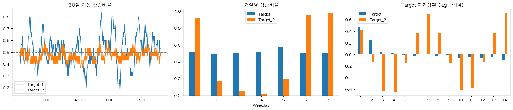
*그림 1. Target 구조 — 30일 이동 상승비율(T1 국면 변화), 요일별 상승비율(T2 요일 지배), Target 자기상관(T2 7일 주기)*

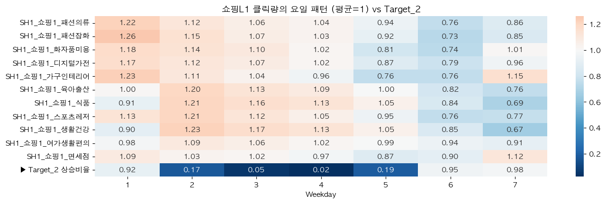
*그림 2. 쇼핑L1 클릭량의 요일 지수와 Target_2 상승비율 — 식품·생활건강은 월~수 많고 금·토 적다*

### 2-3. 항목(변수군)별 지표

| 군 | T1 안정 비율 | T1 최대 신호 | T2 안정 비율 | T2 최대 신호 | 요일 통제 후 최대 신호 (T1 / T2) |
|---|---|---|---|---|---|
| 금융 18 | 24% | 0.098 | 7% | 0.095 | **0.122** / 0.108 |
| 포털 키워드 51 | 24% | 0.103 | 82% | 0.429 | 0.103 / **0.246** |
| 쇼핑 L1 11 · L2 188 | 9% · 19% | 0.105 | 61% · 68% | 0.432 | 0.106 / **0.259** |
| 날씨 15 | 10% | 0.062 | 9% | 0.074 | 0.050 / 0.095 |

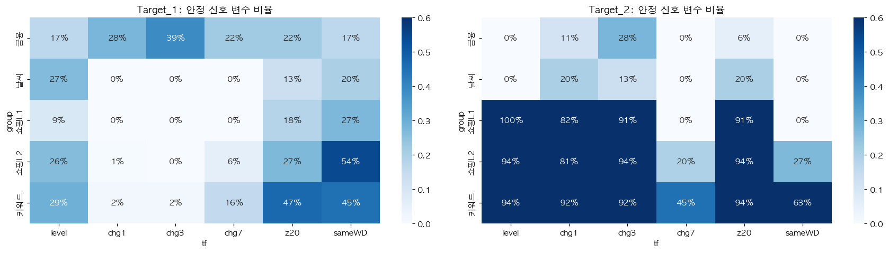
*그림 3. 변수군 × 변환별 안정 신호 비율 — T1은 금융 변화율·쇼핑 sameWD, T2는 쇼핑·키워드 거의 전부*

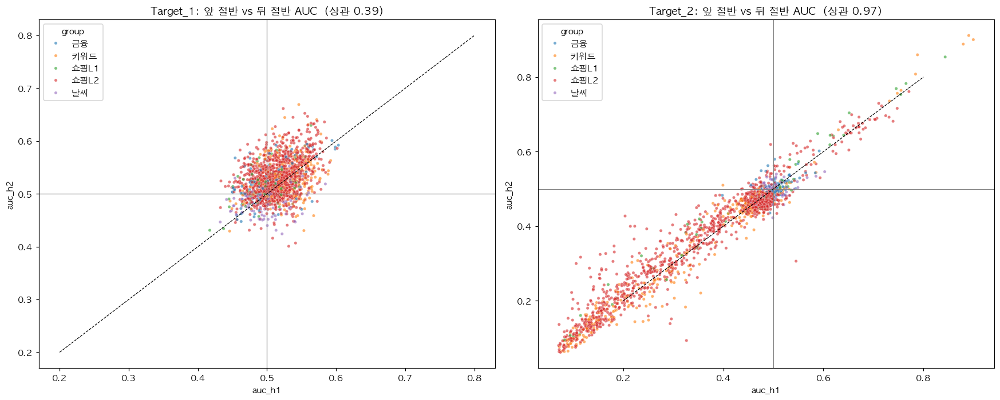
*그림 4. 앞 절반 vs 뒤 절반 AUC — T1 상관 0.39(대부분 잡음), T2 상관 0.97(안정)*

## 3. EDA 결론

**Target_2 (건강식품)**
- **요일 리듬 문제다.** 요일만 써도 AUC 0.926이다. 사람들은 평일(특히 월요일)에 쇼핑을 많이 하고 주말에 적게 한다. "3일 뒤가 평일이면 상승, 주말이면 하락"이다.
- 쇼핑·포털 신호는 앞뒤 기간에서 매우 안정적이다(상관 0.97). 하지만 요일을 통제하면 0.43 → 0.25로 줄어 **절반 가까이가 요일 효과**였다. 나머지 0.25가 요일로 못 가르는 날(월·목)의 추가 정보다.
- 금융·날씨는 무관하다.

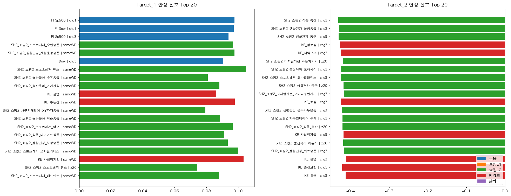
*그림 5. Target별 안정 신호 상위 20 — T1은 미국 지수 전일 변화율, T2는 모두 요일 대리 신호(chg3)*

**Target_1 (KOSPI)**
- **신호가 약하고 시기마다 바뀌는 문제다.** 앞뒤 기간 상관이 0.39로, 대부분의 신호가 잡음이다. 30일 상승비율이 0.17~0.83으로 출렁인다.
- 확실한 단서는 **미국 증시(S&P500·다우) 전일 변화율**이다(+0.10). 요일을 통제하면 0.122로 오히려 강해지므로 진짜 정보다. 하루만 밀어도 사라지므로 최신 값만 유효하다.
- 쇼핑·포털은 "같은 요일 대비"로 바꿨을 때만 약한 신호(+0.08~0.10)가 있다. 서로 상관이 높아 사실상 하나의 "소비 분위기" 정보다.
- Target 어제 값의 자기상관 0.47은 D+3 창이 겹쳐서 생긴 착시이며, 예측 시점에 알 수 없는 값이다 → 사용 금지.

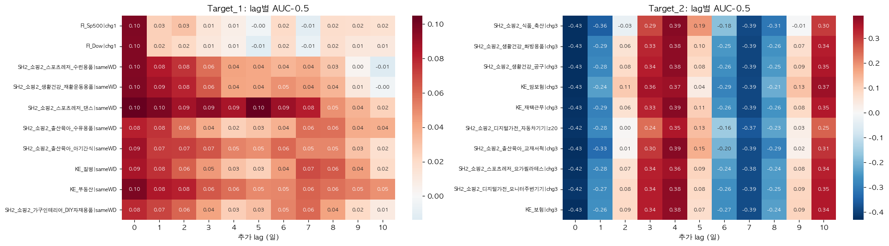
*그림 6. 상위 변수의 lag별 신호 — T1 미국 지수는 하루만 밀어도 소멸, T2는 7일 간격으로 부호 반복*

**공통**
- 금융·쇼핑 원값은 추세가 커서(금융 하루 뒤 자기상관 0.99, Prophet 추세 66%) 그대로 넣으면 "몇 월쯤인가"를 외운다 → 변화량으로 바꿔야 한다.
- 날씨는 우연 수준이다 → 제외한다.

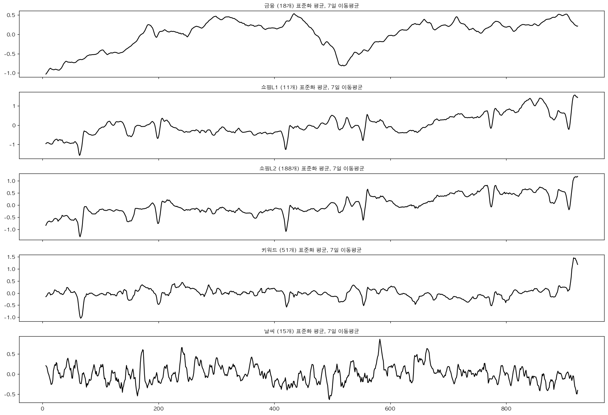
*그림 7. 변수군별 흐름(표준화 평균, 7일 이동평균) — 금융·쇼핑은 추세, 날씨는 추세 없는 출렁임*

## 4. 변수 설계 — 파생변수

| 파생변수 | 계산 (모두 과거 값만) | 근거 (EDA 결론) | 사용 |
|---|---|---|---|
| `fi_chg` | 금융 18개의 1·3·5일 변화율 + 20일 변동성 (72개) | 금융은 추세가 커서 원값 대신 변화량에 신호가 있음 | T1 |
| `us_last` | 미국 지수 3개 전일 변화율에서 주말 0을 직전 거래일 값으로 채움 | 주말 휴장으로 핵심 신호가 7일 중 2일 꺼져 있었음 (일·토 AUC 0.50 → 0.57·0.60) | T1 |
| `samewd_grp` | 쇼핑L1·L2·키워드 각 군의 "오늘 ÷ 지난 4주 같은 요일 평균" 중앙값 (3개) | T1에서 요일 효과를 지운 소비 분위기 신호. 수백 개가 같은 정보라 군별 1개로 압축 | T1 |
| `d3ratio` | "지난 4주 D+3과 같은 요일 평균 ÷ 오늘" (쇼핑L1 11개 + 식품·생활건강 평균, 12개) | T2 정의("3일 뒤 > 오늘")를 과거 같은 요일 값으로 흉내 | T2 핵심 |
| `z20_kw` | 키워드의 (오늘 − 20일 평균) ÷ 20일 표준편차 (50개) | 요일로 못 가르는 월·목에서 보험 키워드가 튀면 덜 오름 | T2 보조 |
| `wd_onehot` | 요일 7칸 0/1 | 숫자 1~7은 크기 순서가 생겨 부적절 | T1·T2 |

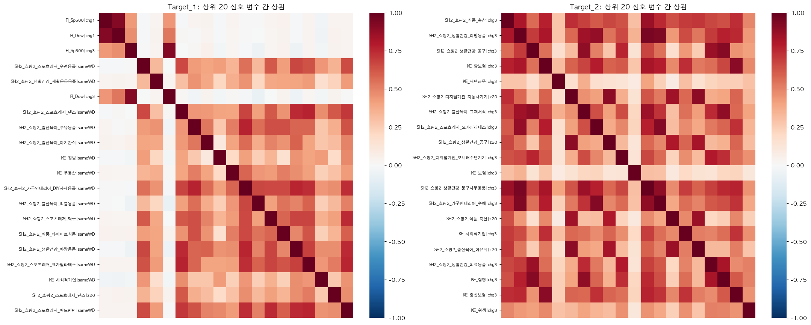
*그림 8. 상위 20 신호 변수 간 상관 — T1은 금융과 소비 분위기 두 덩어리, T2는 사실상 하나의 정보*

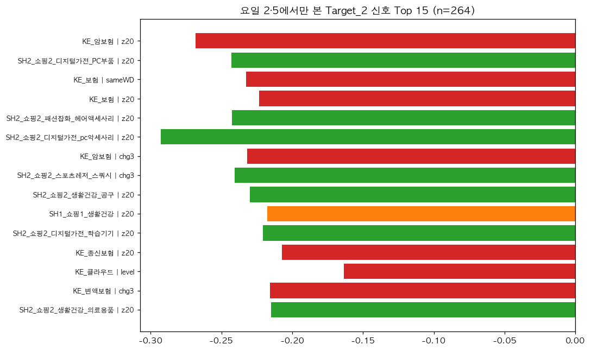
*그림 9. 요일 2·5(월·목)에서만 본 Target_2 신호 — 보험 키워드 z20이 보조 단서*

**전처리**: 값이 하나뿐인 `KE_QR체크인` 제거, 쇼핑·키워드 클릭 0 → 결측(실제 0보다 수집 누락일 가능성이 크다고 판단), 변화율 계산 시 무한대 → 결측, 결측은 각 fold Train의 중앙값으로 대체.

**쓰지 않은 것**: 원값(추세로 시기를 외움), 날씨(우연 수준), Target lag(Leakage), 미래 값을 쓰는 변환(`shift(-n)`, 중앙 정렬 rolling).

## 5. 요일 대비로 설계한 판단

### 5-1. 왜 "요일 대비"가 필요했나

1. **쇼핑·포털 값의 상당 부분이 요일이다.** Prophet 분해에서 포털 변동의 54%, 쇼핑의 18~29%가 요일 성분이다. 원값이나 단순 변화율을 넣으면 모델은 그 변수의 정보가 아니라 **"오늘이 무슨 요일인가"를 다시 배운다.**
2. **실제로 상위 신호가 요일의 다른 이름이었다.** T2 상위 20개(축산·공구·암보험의 3일 변화율 등)가 모두 AUC 0.07 근처였지만, 서로 상관이 거의 1이고 7일 간격으로 부호가 바뀌었다. 요일을 통제하면 0.43 → 0.25로 줄었다.
3. **같은 요일끼리 비교하면 요일 효과가 상쇄된다.** "이번 월요일 ÷ 지난 월요일들"은 둘 다 월요일이라 요일 차이가 사라지고, "평소보다 많다/적다"만 남는다.

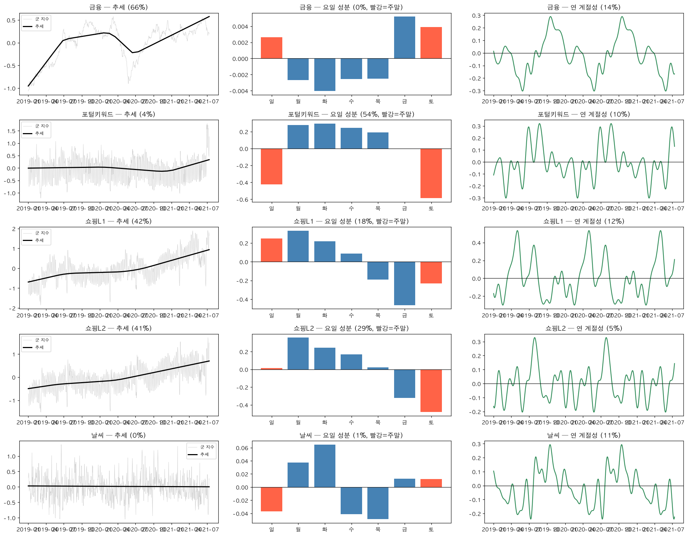
*그림 10. Prophet 성분 분해 — 포털 변동의 54%, 쇼핑의 18~29%가 요일 성분, 금융은 추세 66%*

### 5-2. 왜 "지난 4주" 평균인가

- 주기가 정확히 7일이다(자기상관 7·14일 +0.7). 그래서 7의 배수만큼 떨어진 날과 비교한다.
- 1주 전 하루와만 비교하면 그날의 우연한 튐에 흔들린다. 4주 평균을 쓰면 안정적이다(d3ratio 기준 1주 0.935 → 4주 0.952).
- 과거 값만 쓰므로 Leakage가 없다.

### 5-3. 같은 아이디어, Target마다 반대 방향

| | T1 — 요일을 **지운다** | T2 — 요일을 **이용한다** |
|---|---|---|
| 이유 | KOSPI는 요일과 무관(요일 AUC 0.484)이라 요일 성분은 잡음이다 | 건강식품 상승 자체가 요일 리듬에서 나온다 |
| 파생변수 | `sameWD` = 오늘 ÷ 지난 4주 **같은 요일** 평균 | `d3ratio` = 지난 4주 **D+3과 같은 요일** 평균 ÷ 오늘 |
| 의미 | "요일을 감안해도 평소보다 소비가 많은가" | "평소 리듬대로라면 3일 뒤가 오늘보다 클까" |
| 효과 | T1 안정 신호 비율 최고(쇼핑L2 54%), 빼면 0.599 → 0.584 | 단독 AUC 0.954 (요일만 0.926), 빼면 0.967 → 0.959 |

### 5-4. 요일 번호 확인

설명서에는 "요일 Index"라고만 적혀 있다. 금융 변수 18개 중 16개가 요일 1·7에서 전일 값과 100% 같다(휴장). 그래서 1 = 일요일, 7 = 토요일로 판단했다. 이 확인 과정에서 "주말엔 미국 지수 변화율이 0"이라는 문제를 발견해 `us_last`를 만들었다.

---

## 6. 모델링 — 변수 특징에 맞춘 정규화 방향

### 6-1. 모델링 전에 세운 질문

| # | 질문 | 확인 방법 |
|---|---|---|
| M1 | 모델을 바꾸면 점수가 오르는가, 입력을 바꿔야 오르는가? | 같은 피처로 모델만 바꾸기(E0→E1), 같은 모델로 피처만 바꾸기(E1→E2) |
| M2 | 변수의 특징(잡음·중복·극단값·추세)마다 어떤 과적합 위험이 있고, 무엇으로 막을까? | 아래 6-2 표 |
| M3 | 정규화를 강하게 할수록 좋아지는가, 어딘가에서 멈추는가? | Train·Valid·격차의 변화 추적 (6-4) |
| M4 | 어떤 모델 조합이 시기가 바뀌어도 가장 꾸준한가? | fold 간 표준편차, 평균−표준편차 |

**검증 설계 (모든 실험 공통)**: `TimeSeriesSplit(n_splits=5, gap=3)`로 과거로 학습하고 미래로 검증한다. D+3 정답이 검증 기간과 겹치지 않도록 3일을 비운다. 결측 대체·표준화·변수 선택은 Pipeline 안에서 각 fold의 Train으로만 학습한다. 모델 선택 기준은 **CV 평균 − 표준편차**다.

### 6-2. 변수 특징 → 과적합 위험 → 정규화 방향

| 변수 특징 (근거) | 과적합 위험 | 정규화 방향 | 적용 |
|---|---|---|---|
| **T1 신호가 약하고 잡음이 많다** (앞뒤 기간 상관 0.39, 단일 신호 최대 +0.10) | 모델이 잡음 무늬를 규칙으로 외운다 | 나무를 얕게(`max_depth` 10 → 4 → **2**), 잎마다 최소 20일(`min_samples_leaf=20`) | T1 RF |
| **변수가 많고 서로 겹친다** (원변수 565개, 쇼핑L2 188개가 비슷하게 움직임, S&P·다우·나스닥 상관 높음) | 같은 정보를 여러 번 넣어 외울 거리만 늘어난다. 로지스틱 계수가 불안정해진다 | 피처 수 축소(565 → 82), 군별 중앙값 압축(sameWD 수백 개 → 3개), 나무마다 변수 일부만 사용(`max_features='sqrt'`) | T1·T2 |
| **극단값·한쪽 꼬리** (키워드 왜도 1.62, 0~1 값의 변화율이 크게 튐) | 직선 모델이 극단값 몇 개에 끌려간다 | 값의 순서만 보는 트리 계열 사용, 결측은 중앙값으로 대체 | T1 RF 단독 |
| **추세·국면 변화** (금융 하루 뒤 자기상관 0.99, T1 30일 상승비율 0.17~0.83) | "몇 월쯤인가"를 외워 다른 기간에서 무너진다 | 원값 대신 변화율·비율, 시계열 CV, 평균−std로 선택 | 피처·검증 |
| **단위가 다른 피처** (요일 0/1, 비율, z-score) | L2 벌점이 단위가 큰 변수에만 강하게 걸린다 | 로지스틱 앞에 `StandardScaler`, L2 강도 `C=0.1` | T2 LR |
| **T2 신호가 뚜렷하고 단순하다** (요일만 0.926, 앞뒤 기간 상관 0.97) | 과적합 위험은 작다. 대신 시기별 흔들림이 남는다 | 정규화는 적당히(RF 깊이 4, XGB 깊이 2·λ=5), 성격이 다른 모델의 평균으로 흔들림 감소 | T2 앙상블 |

> 표준화(단위 맞추기)는 로지스틱에만 필요한 전처리다. 원데이터는 이미 열마다 0~1 범위이고, 트리는 단위와 무관하다. 과적합을 막는 것은 **정규화(모델 설정)** 쪽이다.

### 6-3. 시도한 실험과 판단

| 실험 | 가설 | 결과 (T1 / T2 Valid AUC) | 판단 |
|---|---|---|---|
| E0 Baseline | 원본 재현 (565개, RF 깊이 10) | 0.522 / 0.945 | T1은 Train 1.00으로 거의 다 외움 |
| E1 정규화만 | 같은 피처로 나무를 얕게(깊이 4, 잎 20) | 0.540 / 0.937 | 격차는 줄지만 점수는 거의 그대로 → **모델이 아니라 입력이 문제** (M1) |
| E2 EDA 피처 | Target별 파생변수 (82 / 69개) | **0.597 / 0.957** | 가장 큰 도약 |
| E3 자동 선택 | fold 안에서 상위 30개를 자동 선택 | 0.585 / 0.930 | 잡음 속에서 우연을 고름 → 기각 |
| E4 로지스틱 | 가장 단순한 모델 (C=0.1) | 0.565±0.055 / **0.964** | T1은 불안정, T2는 단독 최고 → T2 관계가 직선적 |
| E4 XGB | 얕은 부스팅 (깊이 2, λ=5) | 0.577±0.042 / 0.958 | T1에선 장점이 드러날 신호가 없음 |
| E5 앙상블 | LR + RF + XGB 확률 평균 | 0.583±0.045 / **0.966±0.010** | T2 최선. T1은 불안정한 모델이 섞여 손해 |
| E6 T1 그리드 | RF 깊이 2·3·4·6 × 잎 20·40·80, LR C 0.003~0.1 × 변수 10·20·전체, 금융 축소 | RF 깊이 2·잎 20이 최선 **0.599±0.020**. 깊이는 거의 무관. LR은 평균−std 최고 0.536 | **하이퍼파라미터는 병목이 아님** → 같은 점수라면 더 단순한 쪽 |
| A_ 블록 제거 | 블록이 정말 일하나 (4/5 fold 하락 + 하락폭 ≥ std/2) | samewd 빼면 0.584, d3ratio 빼면 0.959, z20 빼면 0.964 | samewd·d3ratio 유지, z20은 경계 |
| E7 금융 중복 정리 | 상관 0.8 이상은 대표 하나만 (70개) | 0.597±**0.048** | 평균은 같은데 흔들림이 2배 → 기각 |
| E8 주말 보정 | 주말 0인 미국 지수 변화율을 직전 거래일 값으로 | **0.603±0.018** | 평균·흔들림·격차 모두 개선 + 이유가 분명 → 채택 |
| 기타 | seed 5개 평균, 최근 300·450일만 학습, d3ratio 확장(SH2·8주) | ±0.001 이하 | 효과 없음 |
| Prophet | 날짜만 보는 시계열 모델 | 0.565 (1년 주기 끄면 0.492) / 0.947 | 예측은 부족, 성분 분해는 설명 근거로 활용 |

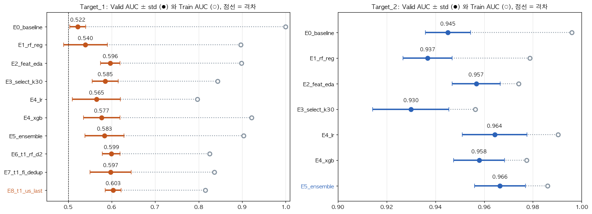
*그림 11. 실험별 Valid AUC ± std(●)와 Train AUC(○) — 점선 길이가 과적합 격차, 굵은 글씨가 최종 선택*

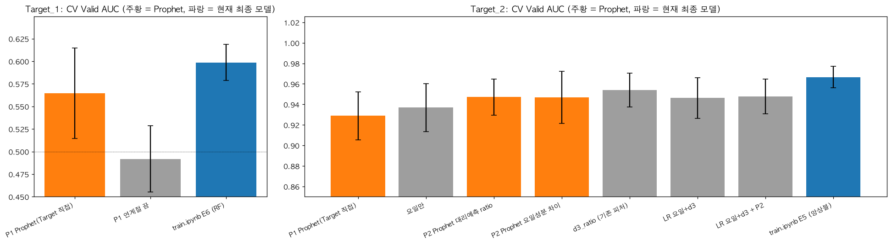
*그림 12. Prophet과 현재 모델의 CV 비교 — 주황 = Prophet, 파랑 = 최종 모델*

### 6-4. 정규화를 강하게 할수록 어떻게 됐나 (M3)

**Target_1** (같은 RF 계열, 정규화 강도 순)

| 단계 | 설정 | Train | Valid | 격차 | 평균−std |
|---|---|---|---|---|---|
| E0 | 깊이 10, 565개 | 1.000 | 0.522 | **0.478** | 0.504 |
| E1 | 깊이 4·잎 20, 565개 | 0.897 | 0.540 | 0.357 | 0.490 |
| E2 | 깊이 4·잎 20, 82개 | 0.898 | 0.596 | 0.302 | 0.574 |
| E6 | **깊이 2**·잎 20, 82개 | 0.825 | 0.599 | 0.227 | 0.579 |
| E8 | 깊이 2·잎 20, 85개 (+주말 보정) | 0.815 | **0.603** | **0.212** | **0.585** |

- 정규화를 강하게 할수록 **격차는 0.48 → 0.21로 꾸준히 줄었다.**
- 그러나 Valid는 **0.60 근처에서 멈췄다.** 더 둔하게 만들어도 오르지 않는다는 것은 남은 한계가 모델이 아니라 **데이터에 담긴 신호의 양**이라는 뜻이다.
- 로지스틱(E4)은 격차는 작지만(0.23) fold 간 흔들림이 0.055로 가장 크다. 격차가 작다고 무조건 좋은 것은 아니다.

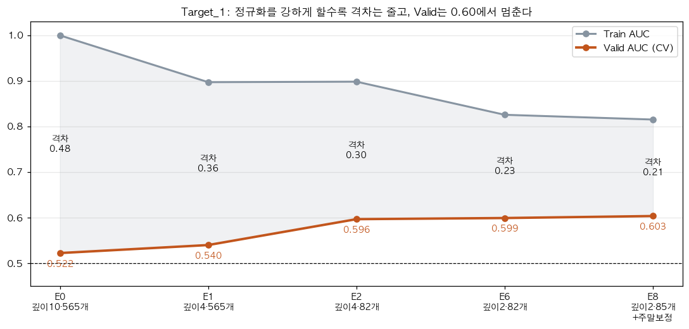
*그림 13. Target_1 정규화 강도별 Train·Valid·격차 — 격차 0.48 → 0.21, Valid는 0.60에서 정체*

**Target_2**

| 단계 | Train | Valid | 격차 | 평균−std |
|---|---|---|---|---|
| E0 Baseline | 0.996 | 0.945 | 0.051 | 0.936 |
| E2 RF + 파생변수 | 0.974 | 0.957 | 0.017 | 0.947 |
| E4 로지스틱 | 0.990 | 0.964 | 0.026 | 0.951 |
| E5 앙상블 | 0.986 | **0.966** | 0.020 | **0.956** |

- 처음부터 격차가 작다(0.05). T2의 과제는 과적합보다 **시기별 흔들림을 줄이는 것**이었고, 앙상블이 그 역할을 했다.

### 6-5. 모델링 인사이트

1. **점수를 올린 것은 입력이었다.** 모델만 바꾼 E1은 +0.018, 피처를 바꾼 E2는 +0.057(T1).
2. **정규화는 점수를 올리기보다 무너지지 않게 한다.** 격차가 0.48 → 0.21로 줄어든 만큼 처음 보는 기간에서 덜 흔들린다.
3. **신호의 성격이 모델을 정한다.** 잡음이 많은 T1은 얕은 RF 하나가, 단순하고 뚜렷한 T2는 로지스틱 중심의 앙상블이 가장 꾸준했다.
4. **같은 점수라면 이유가 있는 쪽, 단순한 쪽을 고른다.** E8은 차이가 작아도 주말 정보 복원이라는 이유가 있어 채택했다. E7은 이유는 있지만 흔들림이 커서 기각했다.

### 6-6. 최종 모델

| | T1 · E8_t1_us_last | T2 · E5_ensemble |
|---|---|---|
| 피처 | 85개 = fi_chg 72 + samewd_grp 3 + wd_onehot 7 + us_last 3 | 69개 = wd_onehot 7 + d3ratio 12 + z20_kw 50 |
| 모델 | 중앙값 대체 → RandomForest (`n_estimators=300, max_depth=2, min_samples_leaf=20, max_features='sqrt'`) | 소프트보팅: ① StandardScaler → 로지스틱 L2 `C=0.1` ② RF `300, max_depth=4, min_samples_leaf=20, sqrt` ③ XGB `300, max_depth=2, learning_rate=0.03, subsample=0.8, colsample_bytree=0.5, min_child_weight=10, reg_lambda=5` |
| CV | **0.603 ± 0.018** (fold 0.575·0.598·0.630·0.603·0.611) | **0.966 ± 0.010** (fold 0.961·0.976·0.964·0.980·0.951) |
| 격차 | 0.212 | 0.020 |

최종 제출 모델은 Train 924일 전체로 다시 학습한다.

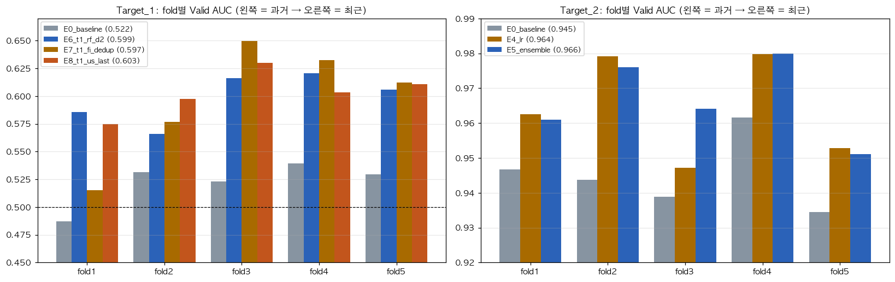
*그림 14. fold별 Valid AUC — T1 E8은 모든 fold 0.57 이상, E7은 fold1에서 0.52로 불안정 / T2 E5는 Baseline을 모든 fold에서 상회*

## 7. 결과·한계

| | Baseline E0 | 최종 | 개선 |
|---|---|---|---|
| T1 | 0.522 | 0.603 | +0.081 |
| T2 | 0.945 | 0.966 | +0.021 |
| **평균** | 0.734 | **0.785** | **+0.051** |

- **Private 현실 기대치는 약 0.77이다.** Private은 200일을 한 번에 채점한다. fold 예측을 이어 붙여 한 번에 계산한 T1 AUC가 약 0.58이라, fold 평균보다 조금 낮게 잡았다. T1은 ±0.06 정도의 변동이 정상 범위다.
- **한계 1**: EDA 변수 선택에 Train 전체를 사용해 CV가 약간 낙관적일 수 있다. fold 안 자동 선택(E3)은 성능이 떨어져 채택하지 않았다.
- **한계 2**: T1은 신호 자체가 약하다. 정규화로 격차는 줄였지만 Valid는 0.60에서 멈췄다.
- **한계 3**: E8의 개선(+0.004)은 잡음 수준이다. 채택 근거는 선택 규칙과 도메인 이유(주말 정보 복원)다.
- **한계 4**: 요일 번호(1=일, 7=토)와 클릭 0의 결측 처리는 데이터에서 추론한 것이다.
